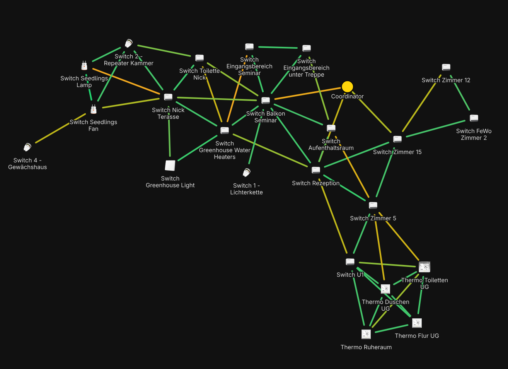

# Zigbee2MQTT map panel

> DRAFT written by the maintainer's assistant. Rewrite in your own words before publishing; keep the facts.

A Home Assistant sidebar panel that shows your Zigbee2MQTT network map as a force graph you can actually work with:
nodes stay where you pin them, links are coloured by the weaker of their two LQI directions, and two numbers tell
you at a glance how strong the router mesh is.

## What it does

- **Pinnable layout** — drag nodes apart, double-click to pin, and the arrangement survives scans and reloads (kept in
  the browser). Ctrl-drag rotates the whole map.
- **Weaker-direction colouring** — every router link has two LQI readings (what each side hears). The colour and the
  "Min LQI" filter use the weaker one, so a link that looks fine from one end but not the other shows as what it is.
- **Mesh numbers** — *connected ≥ C*: the highest LQI at which every router still reaches the coordinator; *redundant
  ≥ R*: the highest LQI at which no single router is a point of failure. Hover to see which link or router limits
  each number, click to set the filter there.
- **Last map, always** — a background automation asks Zigbee2MQTT for the map on a schedule and keeps the answer
  retained on MQTT, so the panel opens with the latest scan even on a device that never scanned, and a scan that
  finishes after you close the page is not lost.
- **Scan while viewing** — while the panel is open it can re-scan at a second, shorter interval; nothing happens when
  nobody is looking. Several open panels share one schedule.
- **Device pictures** from zigbee2mqtt.io (optional), stale-device rings (not seen for 24 h), one-sided links on
  request, routes on request, label search, PNG export.

Everything the panel does goes through Home Assistant's own websocket (`mqtt.publish` and `mqtt/subscribe`): no
extra integration, no access to the Zigbee2MQTT frontend, nothing leaves your network except the optional device
pictures.

## Requirements

- Home Assistant with the **MQTT integration** connected to the same broker as Zigbee2MQTT.
- An **admin user**: the websocket command `mqtt/subscribe` is admin-only, the panel is registered with
  `require_admin: true`.
- Zigbee2MQTT 2.x (tested with 2.14 on an EmberZNet coordinator). Any adapter works; the map comes from
  `bridge/request/networkmap`.
- [HACS](https://hacs.xyz).

## Install

1. HACS → three-dot menu → **Custom repositories** → add `https://github.com/omcular/zigbee2mqtt-map-panel`, type
   **Dashboard** → install. (HACS also adds the file as a dashboard resource; that is harmless and can be removed.)
2. Copy [`packages/zigbee_map_panel.yaml`](packages/zigbee_map_panel.yaml) to `/config/packages/` (enable packages
   once with `homeassistant: packages: !include_dir_named packages` in `configuration.yaml`). Set your Zigbee2MQTT base
   topic in the three places marked at the top of the file if it is not `zigbee2mqtt`.
3. **Restart** Home Assistant (a `panel_custom` entry needs a full restart). "Zigbee map" appears in the sidebar.
4. Open it, press **pull fresh map**, then set the two intervals in **options** (2 h background / 10 min while viewing
   is a sensible start). A scan of a 25-router mesh takes about 75 s with Zigbee2MQTT's own sequential scan.

The package creates three helpers (`input_number.zigbee_map_scan_interval`, `input_number.zigbee_map_live_interval`,
`input_datetime.zigbee_map_last_request`), one toggle (`input_boolean.zigbee_map_fast_scan`) and two automations
(request the map on schedule, keep the latest answer retained on `zigbee_map/latest`).

## Update

After HACS installs a new version, bump the `?v=` in `module_url` to the new version in the package file and restart
Home Assistant. HACS serves `/hacsfiles/` with long cache headers and a custom panel is loaded once per page, so without
the bump a browser keeps the old module for weeks. Hard-reload the tab afterwards (Ctrl-Shift-R).

## Faster scans (optional)

[`networkmap_fast`](https://github.com/Koenkk/zigbee2mqtt-user-extensions) is a Zigbee2MQTT external extension that
scans two routers at a time, puts routers that did not answer last, and reports progress. With it the same 25-router
scan takes 16–22 s and the panel shows "n/m routers" while it runs. Load it in Zigbee2MQTT (Settings → Dev console →
External extensions) and switch on **parallel scan** in the panel's options. Without it, leave the toggle off.

## Reading the map

- A link is an entry in a router's **neighbour table**, not a live route. The tables hold about 16 entries and age in
  and out, so links come and go between scans; judge a path over several scans.
- End devices report nothing themselves; their single link is what the parent sees. They are hidden by default.
- *Dashed grey* = only one side reported the link (usually stale). *Red dashed ring* = not seen for more than 24 h.
- The help menu in the panel explains every control.

## Troubleshooting

- **"admin user needed for mqtt/subscribe"** — log in as an administrator.
- **"timeout: no response in 10 min"** — wrong `base_topic`, Zigbee2MQTT not connected to the broker Home Assistant
  uses, or a scan that never finishes (a router hanging in table paging; `networkmap_fast` has a breaker for that).
- **Panel shows an old version after an update** — bump `?v=` and restart, see *Update*.
- **Nothing in the sidebar** — `panel_custom` is loaded at start-up only; check the HA log for the package.

## Credits

Graph layout by [D3.js](https://d3js.org) (ISC licence, bundled as `dist/d3.v7.min.js`). Device pictures by
[zigbee2mqtt.io](https://www.zigbee2mqtt.io).
